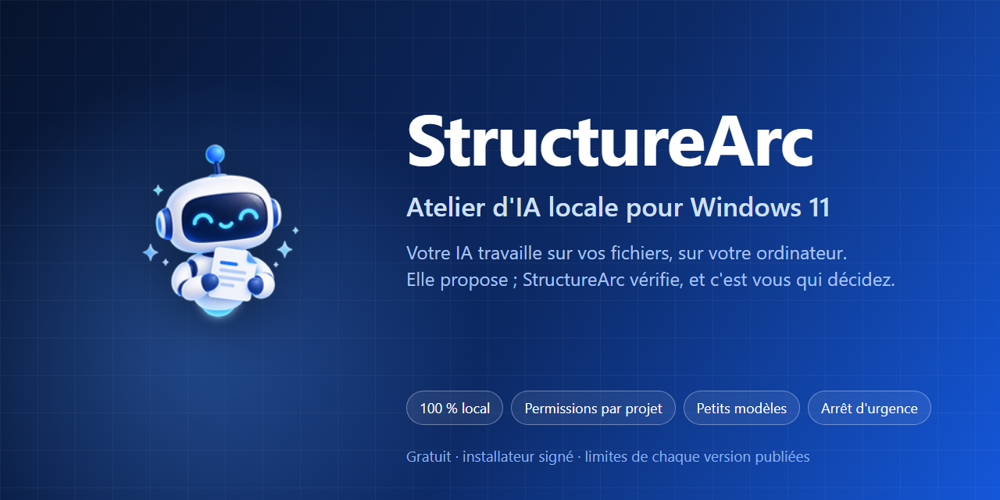
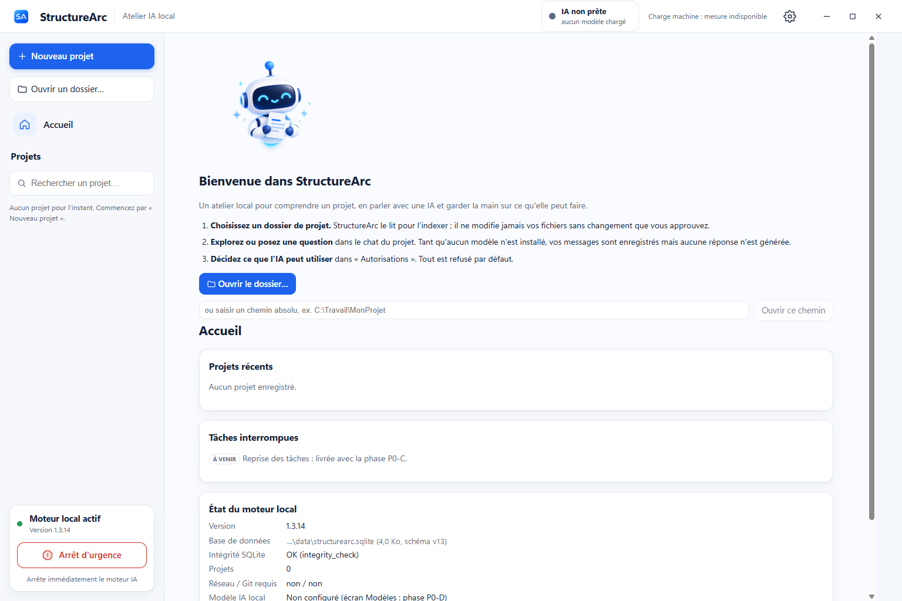
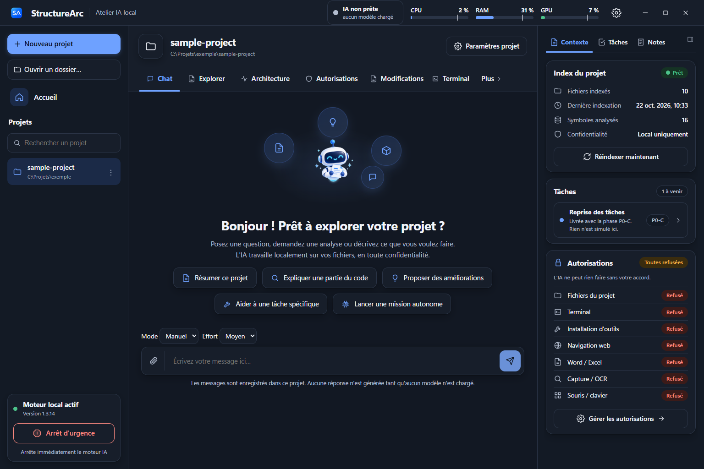
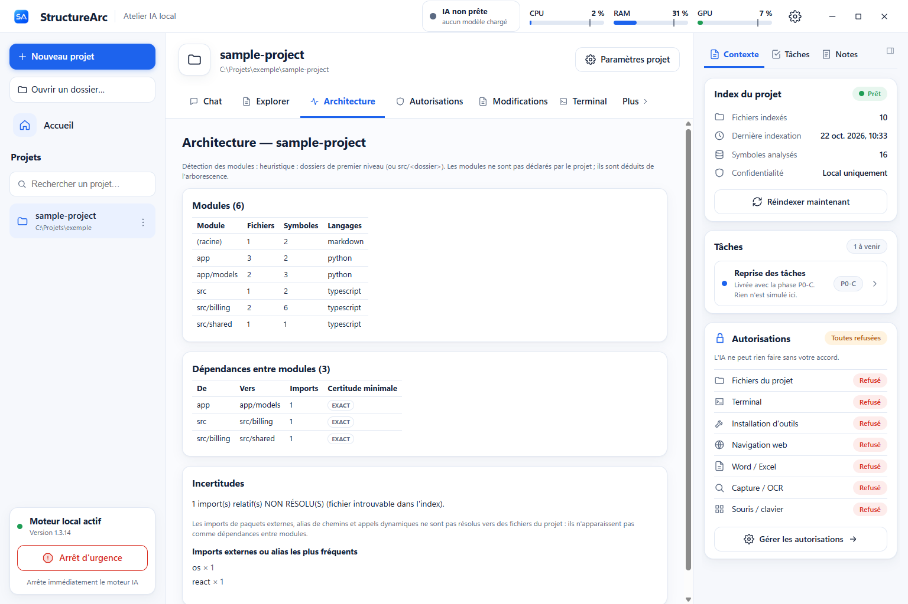
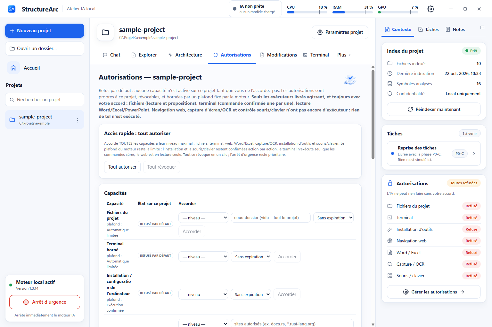
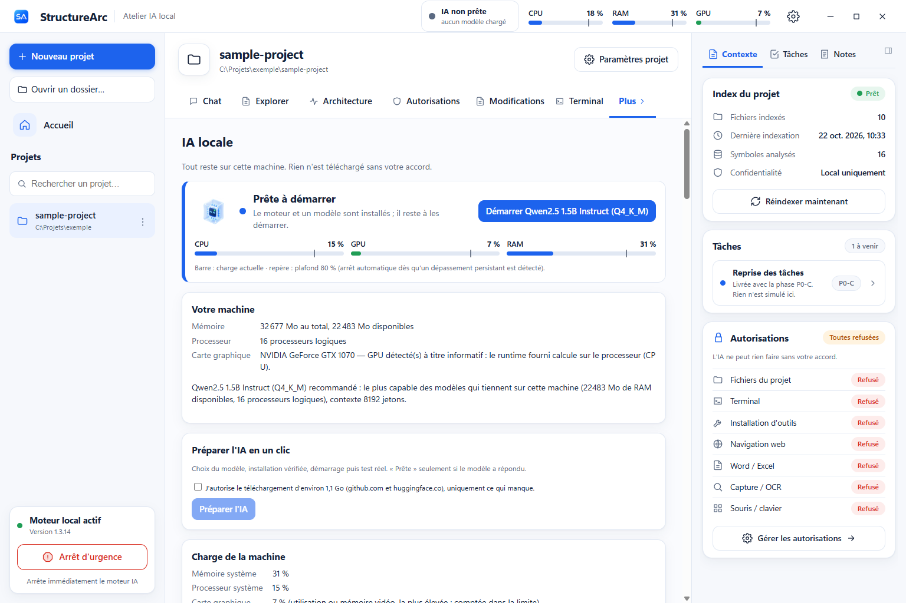

# StructureArc

Application de bureau pour Windows 11 (x64) : travailler sur vos projets avec des modèles locaux ou, dans les versions compatibles, l’API Claude d’Anthropic choisie explicitement. Le mode local ne nécessite aucun compte ; l’API distante nécessite votre clé et envoie le contexte autorisé au fournisseur. Les capacités et limites sont précisées par version.

> **Ce dépôt ne contient que les publications** (installateurs signés en pièces jointes de Release, empreintes, notes et limites de chaque version). Aucun code source n'est publié ici.

## Télécharger
Dernière version : **1.3.24** — page *Releases* → `StructureArc_1.3.24_x64-setup.exe`. Vérifiez toujours la signature et l'empreinte : voir [VERIFIER.md](VERIFIER.md).

| Version | Installateur signé | Taille | SHA-256 | Détails |
|---|---|---|---|---|
| 1.3.24 | `StructureArc_1.3.24_x64-setup.exe` | 23.1 Mo | `dfdde21ae0fbe288…` | [notes et limites](versions/v1.3.24/) |
| 1.3.23 | `StructureArc_1.3.23_x64-setup.exe` | 23.1 Mo | `94fe55744bb3712e…` | [notes et limites](versions/v1.3.23/) |
| 1.3.21 | `StructureArc_1.3.21_x64-setup.exe` | 23.1 Mo | `335425c0b5f12fe1…` | [notes et limites](versions/v1.3.21/) |
| 1.3.20 | `StructureArc_1.3.20_x64-setup.exe` | 23.1 Mo | `f44f6b43912c7fec…` | [notes et limites](versions/v1.3.20/) |
| 1.3.19 | `StructureArc_1.3.19_x64-setup.exe` | 23.0 Mo | `ebe1ff017ce553f6…` | [notes et limites](versions/v1.3.19/) |
| 1.3.18 | `StructureArc_1.3.18_x64-setup.exe` | 22.9 Mo | `1d4f876199befa4a…` | [notes et limites](versions/v1.3.18/) |
| 1.3.17 | `StructureArc_1.3.17_x64-setup.exe` | 22.9 Mo | `33e769a17e47560f…` | [notes et limites](versions/v1.3.17/) |
| 1.3.16 | `StructureArc_1.3.16_x64-setup.exe` | 22.8 Mo | `36de85b95d717e28…` | [notes et limites](versions/v1.3.16/) |
| 1.3.13 | `StructureArc_1.3.13_x64-setup.exe` | 22.7 Mo | `49dfff31265701eb…` | [notes et limites](versions/v1.3.13/) |
| 1.3.12 | `StructureArc_1.3.12_x64-setup.exe` | 22.7 Mo | `48a0e0e4f246e93c…` | [notes et limites](versions/v1.3.12/) |
| 1.3.11 | `StructureArc_1.3.11_x64-setup.exe` | 22.7 Mo | `ea80b00f2e4989e9…` | [notes et limites](versions/v1.3.11/) |
| 1.3.10 | `StructureArc_1.3.10_x64-setup.exe` | 22.7 Mo | `b9904cf6f80c9ace…` | [notes et limites](versions/v1.3.10/) |
| 1.3.9 | `StructureArc_1.3.9_x64-setup.exe` | 22.6 Mo | `96ddfb90d406ffa3…` | [notes et limites](versions/v1.3.9/) |
| 1.3.8 | `StructureArc_1.3.8_x64-setup.exe` | 22.6 Mo | `b64a02e44186fecf…` | [notes et limites](versions/v1.3.8/) |
| 1.3.7 | `StructureArc_1.3.7_x64-setup.exe` | 22.6 Mo | `e1fe9395f27f90e1…` | [notes et limites](versions/v1.3.7/) |
| 1.3.6 | `StructureArc_1.3.6_x64-setup.exe` | 22.5 Mo | `0b55b477217aa2d4…` | [notes et limites](versions/v1.3.6/) |
| 1.3.5 | `StructureArc_1.3.5_x64-setup.exe` | 22.5 Mo | `4066daf2d0840ffe…` | [notes et limites](versions/v1.3.5/) |
| 1.3.4 | `StructureArc_1.3.4_x64-setup.exe` | 22.5 Mo | `55242cc4b76c638f…` | [notes et limites](versions/v1.3.4/) |
| 1.3.3 | `StructureArc_1.3.3_x64-setup.exe` | 22.5 Mo | `11b0b908463f3715…` | [notes et limites](versions/v1.3.3/) |
| 1.3.2 | `StructureArc_1.3.2_x64-setup.exe` | 22.5 Mo | `cd925a1ae42ac9d5…` | [notes et limites](versions/v1.3.2/) |
| 1.3.1 | `StructureArc_1.3.1_x64-setup.exe` | 22.5 Mo | `b99e83d13157efd0…` | [notes et limites](versions/v1.3.1/) |
| 1.3.0 | `StructureArc_1.3.0_x64-setup.exe` | 22.4 Mo | `557400b5409540fc…` | [notes et limites](versions/v1.3.0/) |
| 1.2.4 | `StructureArc_1.2.4_x64-setup.exe` | 22.4 Mo | `363d436dea3db456…` | [notes et limites](versions/v1.2.4/) |
| 1.2.3 | `StructureArc_1.2.3_x64-setup.exe` | 22.4 Mo | `40da6e568df47068…` | [notes et limites](versions/v1.2.3/) |
| 1.2.2 | `StructureArc_1.2.2_x64-setup.exe` | 22.3 Mo | `198844b331a6bd49…` | [notes et limites](versions/v1.2.2/) |
| 1.2.1 | `StructureArc_1.2.1_x64-setup.exe` | 22.3 Mo | `bd0f9027f1124489…` | [notes et limites](versions/v1.2.1/) |
| 1.2.0 | `StructureArc_1.2.0_x64-setup.exe` | 22.3 Mo | `8f217a503585a17a…` | [notes et limites](versions/v1.2.0/) |
| 1.1.0 | `StructureArc_1.1.0_x64-setup.exe` | 22.2 Mo | `658e6271cfe3eb5e…` | [notes et limites](versions/v1.1.0/) |
| 1.0.0 | `StructureArc_1.0.0_x64-setup.exe` | 22.2 Mo | `4b8bf6bc63da27df…` | [notes et limites](versions/v1.0.0/) |

## Aperçu
Captures historiques sur un projet d’exemple ; elles illustrent les principales vues et peuvent différer de la version actuelle. Les chemins de l’ordinateur de test sont remplacés par un chemin neutre.

| | |
|---|---|
|  Accueil : choisir un dossier de projet |  Chat du projet, avec l'état de l'index et des autorisations |
|  Thème sombre |  Architecture déduite du projet (modules et dépendances) |
|  Autorisations par projet : tout est refusé par défaut |  IA locale : mesure de la machine et choix du modèle |

## Pourquoi StructureArc ?
Beaucoup d'outils font tourner une IA sur votre ordinateur. StructureArc est conçu pour l'aider à **travailler sur de gros projets, avec les outils réellement disponibles et documentés dans chaque version** — même quand le modèle est petit :

- **Des outils activables par mission et par version** : fichiers, terminal, web/recherche, lecture Office, agents et compétences ; MCP et lecture d'écran ne sont annoncés que selon les limites du build. Les actions machine (souris/clavier et installation de logiciels) ne doivent pas être supposées disponibles : elles sont explicitement signalées comme non implémentées dans les limites publiques V1.3.1.
- **Une méthode de découpage pour petits modèles** : un gros projet est découpé en étapes qui tiennent dans la fenêtre d'un petit modèle (plan, tâches dépendantes, contrats, contexte compilé, rapports qui remontent), au lieu d'exiger un modèle géant.
- **Des optimisations mesurées pour petits ET gros modèles** : choix du modèle par tâche d'après des mesures, estimation fine de la mémoire (avec ou sans carte graphique), déport de couches, cache réduit, chargement sans copie en RAM, plafond de charge — avec une preuve publique encore limitée à la machine de référence, pas une garantie pour chaque PC.
- **Le bon modèle pour votre machine** : mesure du matériel, banc de qualité et d'appels d'outils, tableau publié, bascule entre modèles selon la tâche.
- **Un cadre qui vous garde le contrôle sans freiner le travail** : permissions par projet que vous ouvrez aussi largement que vous le voulez, journal d'audit, arrêt d'urgence, ressources de l'ordinateur protégées.
- **Mode local sans cloud obligatoire** : pas de Docker, Python ou Git requis pour le chat local avec un modèle installé. Le fournisseur distant est optionnel et dépend de ses propres conditions et tarifs. Installateur signé, empreintes publiées et limites précisées par version.

Détails, preuves et ce que nous ne prétendons pas : **[POURQUOI.md](POURQUOI.md)**.

## État honnête
- Testé sur **un seul** ordinateur (Windows 11, 32 Go, GTX 1070). Chaque version a son fichier de limites (`LIMITES_*.md`) : lisez-le avant d'installer.
- Pour la version publique **1.3.24**, le modèle n'est pas inclus dans l'installateur standard ; il est installé ou importé par l'utilisateur, avec vérification d'empreinte. Un éventuel installateur hors-ligne en développement n'est pas une publication.
- Usage gratuit, sans exploitation commerciale par autrui : voir [LICENSE.md](LICENSE.md).

## Édité par
**[le-bon.contact](https://le-bon.contact)** — assistance et dépannage informatique à Agen.

- Site de l'entreprise : <https://le-bon.contact>
- Projet personnel et présentation : <https://kevin-moniaux.com>

## Contenu du dépôt
- `releases.json` — index lisible par machine (versions signées) ; `update/latest.json` — manifeste de la dernière version signée.
- `versions/vX.Y.Z/` — présentation, nouveautés, limites et empreintes de chaque version.
- [POURQUOI.md](POURQUOI.md) · [CHANGELOG.md](CHANGELOG.md) · [VERIFIER.md](VERIFIER.md) · [SECURITY.md](SECURITY.md) · [LICENSE.md](LICENSE.md) · [THIRD_PARTY_NOTICES.md](THIRD_PARTY_NOTICES.md)
